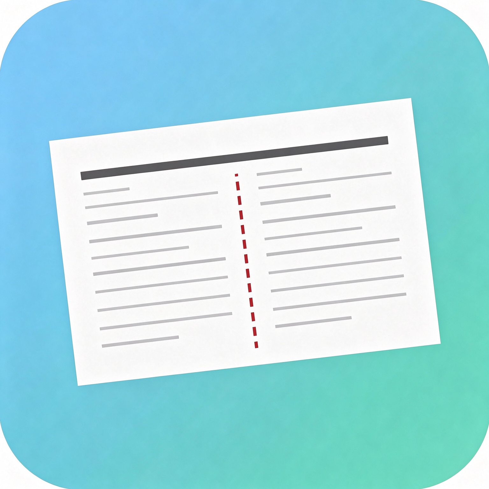

# 卷裁

> 把一张 A3 试卷从中间拆开，变成两张 A4，直接打印出来。



老师、家长、打印店常遇到这情况：手里只有 A3 版面的试卷（一张纸左右或上下并排两道题），但打印机只有 A4 纸。要么缩印得看不清，要么手动裁一半再印一半，中间那道**密封线**还会跑到纸边上。

卷裁就干这一件事：**拆开、去掉密封线、按 A4 纵向打出来**。

---

## 功能

- 支持 PDF / JPG / PNG / BMP / TIFF，多页 PDF 逐页拆分
- 自动判断 A3 横向（左右拆分）/ 纵向（上下拆分），也可手动指定
- **红色分割线可拖动**：拖到哪就按哪拆，范围 20%–80%，按页记忆
- 拆分预览 + A4 结果预览（两张独立显示，带页号和裁切提示）
- **去密封线**：开关 + 裁切宽度（mm，默认 8mm），奇数页裁左、偶数页裁右
- 直接选打印机打印，强制 **A4 纵向**、适配安全边距、中缝不留白
- 打印后**核验打印队列和打印服务事件**，只有确认失败才报警，绝不把"提交成功"说成"已打印"
- 打印失败自动保留 A4 PDF（合并版 + 单页版），不重复发送任务
- 直接把文件拖进窗口就能加载（PDF / 图片都行）

---

## 两种用法

### 一、直接下安装包（推荐给不折腾的人）

去 [Releases](../../releases) 下载 `卷裁_v8_安装版.exe`，双击：

1. 中文安装向导，选安装目录（默认 D 盘，可自选）
2. 点「安装」
3. 桌面出现「卷裁」快捷方式，双击就能用

**不需要装 Python、不需要联网、不需要管理员权限。** 安装包自带 Python 运行时和全部依赖。

卸载：Windows 设置 → 应用 → 「卷裁」，或运行安装目录里的卸载程序。

### 二、从源码跑（给想改代码的人）

要求：Windows 系统 + Python 3.9 或更新版本（需包含 tkinter，官方安装包默认就有）。

```bat
git clone <本仓库地址>
cd 卷裁开源版
pip install -r requirements.txt
python app.py
```

或者直接双击 `启动工具.bat`（它会自动找 PATH 里的 python）。

> `启动工具.bat` 如果检测到同目录下有 `lib\` 文件夹，就会走"便携模式"用自带依赖；没有就退回用系统 Python。仓库里不含 `lib\`，所以默认走系统 Python。

---

## 使用步骤

1. 点「打开文件」，选 A3 的 PDF / JPG / PNG，或者直接把文件拖进窗口
2. 默认自动识别横/纵；要强制就看「横向左右」或「纵向上下」
3. 需要去密封线：勾选「去密封线」，填裁切宽度（默认 8mm，可调 0–60mm）
4. 左边是原图预览，右边是 A4 结果预览；开启去密封线时，两侧会用**半透明灰色斜纹**标出将裁掉的区域，并写明「奇数页N 裁左 / 偶数页N 裁右」
5. 点「生成 A4 PDF」导出；或选好打印机直接点「打印」——**不弹通道选择、不问是/否，点一下就直接打**
6. 提交后工具自动核验打印队列与打印服务事件；**只有核验失败**才用中文提示并自动保留 A4 PDF

---

## 去密封线规则

| 项 | 说明 |
|---|---|
| 处理顺序 | **先裁切，再等比（contain）适配标准 A4 白底页**，绝不拉伸 |
| 奇数输出页（第 1、3、5… 张 A4） | 裁掉**左侧**密封线区域 |
| 偶数输出页（第 2、4、6… 张 A4） | 裁掉**右侧**密封线区域 |
| 多页 PDF | 输出页序号跨页全局连续累加，逐页按上述规则执行 |
| 设置一致性 | 开关与 mm 是全局设置，同一批文件/多页 PDF 内一致，切换文件不重置 |
| 关闭开关 | 走原拆分逻辑（`seal_mm=0`），与原版**逐像素一致** |
| 页面尺寸 | 始终 1654×2339 px @200dpi = 标准 A4 纵向；导出 PDF 每页 595.28×841.89 pt |
| 纵向上下模式 | 输出页经 90° 旋转后仍按奇偶裁左/右，裁切线标注在 A4 结果预览上 |

---

## 环境依赖

| 依赖 | 用途 |
|---|---|
| `PyMuPDF`（`fitz`） | PDF 渲染、页面提取 |
| `Pillow`（`PIL`） | 图像裁切、缩放、合成 |
| `pywin32` | 打印机枚举、打印 DC、Word COM 直印 |
| `tkinter` | 图形界面（Python 标准库，Windows 官方安装包自带） |

安装：`pip install -r requirements.txt`

---

## 自测

```bat
python app.py --selftest
```

自测包含：依赖来源校验、A3 横/纵拆分、去密封线全量验证 + 原功能逐像素回归、打印机枚举、DC 强制 A4 纵向对照实验、打印路径 dry_run。

其他验证脚本：

| 脚本 | 验证什么 |
|---|---|
| `verify_seal.py` | 去密封线裁切结果 |
| `verify_print.py` | 打印 DC 强制 A4 纵向 |
| `verify_launch.py` | 快捷方式启动链路 |
| `verify_new_features.py` | 拖放 + 红线拖动 |
| `verify_printer_fix.py` | 打印机选中与错误提示 |
| `verify_print_guard.py` | 打印结果核验与回退 |
| `verify_word_print.py` | Word 直印分页 |
| `real_gui_verify.py` | 真实鼠标手势 + 真实拖放消息 |

---

## 说明与限制

- 纵向上下拆分时，每半张是 A4 横向比例，为符合「A4 纵向打印」会自动旋转 90°；横向左右拆分不需要旋转
- 去密封线按固定 mm 裁边缘，**不做密封线内容识别**；如果密封线不在页面最外侧，请手动调宽度
- 裁切后内容等比缩小并居中，A4 页两侧会留白边（8mm 时约 63px，居中后每侧约 31px），属正常
- 打印安全边距默认 3mm，避免内容被裁；同时保证每半张独立占满一页 A4，重拼后中缝无缝
- 虚拟打印机（如 Microsoft Print to PDF）打印时会弹保存对话框，属正常
- **仅支持 Windows**（依赖 pywin32 的打印机 API 和 Word COM）
- 只读读取本地文件，不联网、不上传任何内容

### 一个已知的坑

`启动工具.bat` 刻意保持**纯 ASCII** 且不使用 `chcp 65001`。cmd.exe 按 OEM 代码页逐行解析 .bat，UTF-8 中文 + `chcp 65001` 会导致后续命令行解析错乱，让双击启动失败。这是踩过的坑，别改回去。

---

## 更新日志

从 v1 到 v8 的完整变更记录（含拖放闪退的根因、打印机白名单的判定依据、打印结果核验的设计）都在 [CHANGELOG.md](CHANGELOG.md)。

---

## 开源协议

本项目采用 **GNU Affero General Public License v3.0（AGPL-3.0）**，详见 [LICENSE](LICENSE)。

为什么是 AGPL 而不是 MIT？因为本项目使用了 **PyMuPDF**，它本身是 AGPL-3.0 授权且具有传染性，所以整个项目也必须以 AGPL 开源。这不是选择，是依赖的硬要求。

这意味着：

- ✅ 你可以自由使用、修改、分发，也可以收费
- ✅ 商用没有问题
- ⚠️ 你修改后的版本**也必须以 AGPL 开源**
- ⚠️ 即使只作为网络服务提供，也必须公开源码

如果你需要闭源商用，请联系作者获取商业授权。
